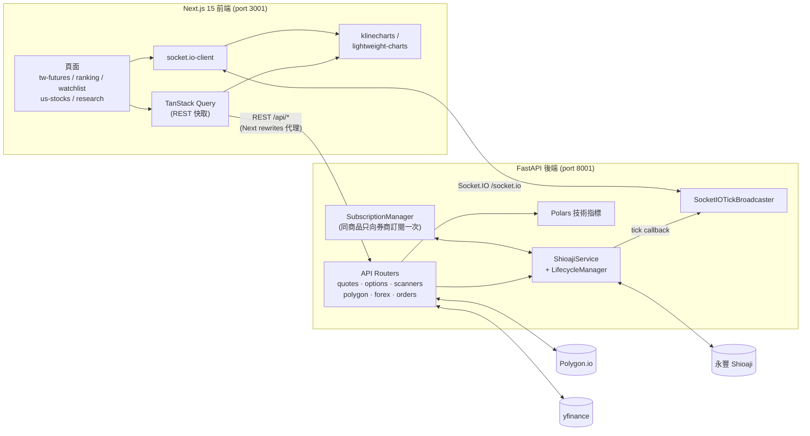

# Sinotrade API — 台股／美股即時行情與交易平台

以 **FastAPI + Next.js** 打造的全端金融行情平台。後端串接永豐金 **Shioaji** SDK（台股、台指期、台指選擇權）與 **Polygon.io / yfinance**（美股、匯率），透過 **REST + Socket.IO** 提供即時報價、K 線、技術指標、排行榜與模擬下單；前端以 Next.js 15 呈現即時圖表與交易介面。

> ⚠️ 本專案僅用於學習與研究，Shioaji 一律以 **模擬模式 (`simulation=True`)** 登入，不會下真實委託。

---

## ✨ 功能一覽

| 模組 | 說明 | 主要 API / 頁面 |
| --- | --- | --- |
| 台股／期貨報價 | 即時報價、歷史 K 線（1m/5m/日線…）、合約資訊 | `GET /api/quote/{symbol}`、`/api/klines/{symbol}`、`/tw-futures` |
| 技術指標圖表 | K 線 + MA / MACD / RSI / KD / 布林通道，Polars + polars-talib 計算 | `GET /api/chart/{symbol}`、`/api/chart/multi` |
| 即時推送 | Shioaji tick → Socket.IO 廣播，前端即時更新 K 棒 | Socket.IO `subscribe_klines` / `kline_tick` |
| 台指選擇權 | 合約篩選、履約價列表、訂閱即時報價、歷史資料 | `/api/options/*`、`/compare-options-table` |
| 台股排行榜 | 漲跌幅、成交量、成交值等排行（Shioaji scanners） | `/api/scanners/{type}`、`/ranking` |
| 自選股 | 多檔報價監控、URL 參數分享清單 | `/watchlist` |
| 美股專區 | Polygon.io 報價、K 線、代號搜尋、市場狀態 | `/api/polygon/*`、`/us-stocks` |
| 研究分析 | USD/TWD 匯率 vs. 加權指數滾動相關係數 + 「台幣升值即買入」策略回測 | `GET /api/forex/analysis`、`/research` |
| 模擬下單 | API Key + 角色權限（只有 `trader` 能下單） | `POST /api/order`、`/quick-trade` |
| 用量監控 | Shioaji 流量／連線用量、訂閱狀態除錯 | `/api/usage`、`/api/subscriptions/status` |

完整 API 文件：啟動後端後開啟 `http://localhost:8001/docs`（Swagger UI）。

---

## 🏗️ 系統架構



### 資料流（即時 K 線）

1. 前端送出 `subscribe_klines { symbol, interval }`。
2. `SubscriptionManager` 以 **參考計數** 記錄訂閱者；只有第一位訂閱者會觸發向 Shioaji 訂閱，最後一位離開才取消，避免重複訂閱吃光券商連線額度。
3. 後端先回傳 `historical_klines`（歷史資料 + 指標）。
4. Shioaji 在 **SDK 自己的執行緒** 觸發 tick callback，`SocketIOTickBroadcaster` 把它安全地轉回 asyncio event loop，再以 `kline_tick` 廣播給訂閱的 client。

---

## 💡 技術亮點

- **券商連線的生命週期管理**：Shioaji 有同時登入／訂閱數上限，開發時 `uvicorn --reload` 會不斷重啟，舊連線沒釋放就會被鎖。`LifecycleManager` 統一處理 *取消訂閱 → 登出 → 等待釋放 → 取消 pending task* 的順序，並在 FastAPI `lifespan`、`atexit`、`SIGINT/SIGTERM` 三個出口都掛上清理，失敗時再退回 emergency logout。
- **跨執行緒事件橋接**：SDK callback 在非 async 執行緒執行，需要把資料轉交 asyncio loop 後才能 emit Socket.IO 事件。
- **訂閱去重**：多個瀏覽器分頁看同一檔商品只佔用一個上游訂閱（`GlobalSubscriptionManager`）。
- **Polars 取代 pandas 計算指標**：`/api/benchmark/{symbol}` 提供兩者的效能比較端點。
- **K 線資料補齊策略**：依週期選擇 Shioaji kbars、ticks 聚合或日線聚合（`_get_klines_hybrid_5m` 等），處理盤中資料不足的情況。
- **前後端型別同步**：`scripts/export_openapi.py` + `generate_types.py` 由 Pydantic 模型產生 TypeScript 型別。
- **角色權限**：`X-API-Key` → `viewer` / `trader`，下單端點以 FastAPI `Depends` 做權限檢查。

---

## 🧰 技術棧

| 層 | 技術 |
| --- | --- |
| 後端 | Python 3.13、FastAPI、Uvicorn、fastapi-socketio、Pydantic、Loguru、uv |
| 資料 | Shioaji、Polygon.io、yfinance、Polars + polars-talib、pandas、cachetools |
| 前端 | Next.js 15 (Turbopack)、React 18、TypeScript、Tailwind CSS、shadcn/ui (Radix) |
| 前端狀態／資料 | TanStack Query、Zustand、socket.io-client |
| 圖表 | klinecharts、lightweight-charts、Recharts |
| 品質 | Ruff、mypy、pytest、pre-commit |

---

## 📁 專案結構

```
sinotrade-api/
├── backend/
│   ├── src/
│   │   ├── main.py                 # FastAPI app、lifespan、CORS、Socket.IO 掛載
│   │   ├── api/                    # 路由：quotes, options_quotes, scanners, polygon_quotes,
│   │   │                           #       forex_analysis, orders, usage, websocket_quotes
│   │   ├── services/
│   │   │   ├── shioaji_service.py          # Shioaji 封裝（報價、K 線、排行、下單）
│   │   │   ├── lifecycle_management.py     # 登入／登出／清理流程
│   │   │   ├── subscription_manager.py     # 訂閱參考計數
│   │   │   ├── socketio_manager.py         # Socket.IO 事件與 tick 廣播
│   │   │   ├── polars_technical_analysis_service.py
│   │   │   ├── polygon_service.py
│   │   │   └── auth_service.py             # API Key / 角色
│   │   ├── models/                 # Pydantic 領域模型、技術指標模型
│   │   └── utils/symbol_mapping.py
│   ├── tests/                      # pytest（unit / integration / contract）
│   ├── scripts/                    # OpenAPI 匯出、TS 型別產生
│   ├── *.ipynb                     # Shioaji / Polygon 研究筆記本（已清除輸出）
│   └── pyproject.toml / uv.lock
├── frontend/
│   └── src/
│       ├── app/                    # Next.js App Router 頁面（test-* 為開發測試頁）
│       ├── components/             # chart/、ranking/、trading/、layout/、ui/
│       ├── services/               # api.ts、klineSocketIO.ts、usStockSocketIO.ts
│       ├── hooks/ store/ types/ utils/
├── scripts-windows/                # Windows 啟動腳本（config.bat 設定 port）
├── docs/                           # 架構、效能優化、跨平台說明
├── sinotrade.bat                   # Windows 快速指令
└── Makefile                        # Linux/macOS 指令
```

---

## 🚀 快速開始

### 需求

- Python **3.13**（由 [uv](https://docs.astral.sh/uv/) 自動管理）
- Node.js 22 + **pnpm**
- 永豐 Shioaji API Key（[申請說明](https://sinotrade.github.io/)）；美股功能需要 Polygon.io API Key（可選）

### 1. 設定環境變數

```bash
cp backend/.env.example backend/.env
```

編輯 `backend/.env`，填入：

```env
SHIOAJI_API_KEY=...
SHIOAJI_SECRET_KEY=...
POLYGON_API_KEY=...      # 選填，美股功能使用
```

前端的 `frontend/.env.local` 由 `scripts-windows/config.bat` 自動產生（指向後端 port）。

### 2. 安裝依賴

```bash
sinotrade install        # Windows
make install             # Linux / macOS
```

> pnpm 10+ 預設封鎖套件的 install script；本專案在 `frontend/pnpm-workspace.yaml` 已允許 `sharp`、`unrs-resolver`。

### 3. 啟動

```bash
sinotrade dev            # Windows：前後端各開一個視窗
```

| 服務 | 網址 |
| --- | --- |
| 前端 | http://localhost:3001 |
| 後端 API | http://localhost:8001 |
| Swagger | http://localhost:8001/docs |

Port 可在 `scripts-windows/config.bat` 修改。Linux/macOS 使用 `make dev-backend` / `make dev-frontend`（預設 8000 / 3000）。

### 測試

```bash
cd backend
uv run pytest tests --ignore=tests/integration
```

> 多數測試需要可登入的 Shioaji 帳號（模擬環境）。

---

## 🔐 安全性

- 所有金鑰只放在 `backend/.env`（已被 `.gitignore` 排除）；`.env.example` 只保留佔位字串。
- Jupyter 筆記本提交前清除輸出，避免把帳號資訊、金鑰印在 cell output 裡。
- 示範用的 `viewer-key` / `trader-key` 寫在 `auth_service.py`，僅供本機展示，正式環境應改為資料庫 + 雜湊。
- 部分報價端點的 API Key 驗證目前為了開發方便暫時關閉（見 `api/quotes.py` 註解）。

---

## 🗺️ 已知限制與後續方向

- 期貨／選擇權下單尚未實作（目前僅股票模擬單）。
- `smart_cache_service.py`（L1 記憶體 + L2 Redis）與 `websocket_optimizer.py` 為優化草案，尚未接上主流程。
- `/portfolio`、`/backtesting` 頁面為預留路由。
- 前端 `test-*` 頁面為開發期元件驗證頁。

---

## 📝 延伸文件

- [跨平台開發指南](docs/CROSS-PLATFORM.md)
- [環境設定](docs/ENVIRONMENT-SETUP.md)
- [效能優化路線圖](docs/performance-optimization-roadmap.md)
- [後端開發參考](backend/docs/backend-development-reference.md)
- [選擇權 API 指南](backend/docs/options-api-guide.md)
- [前端圖表架構](frontend/docs/chart-architecture.md)
