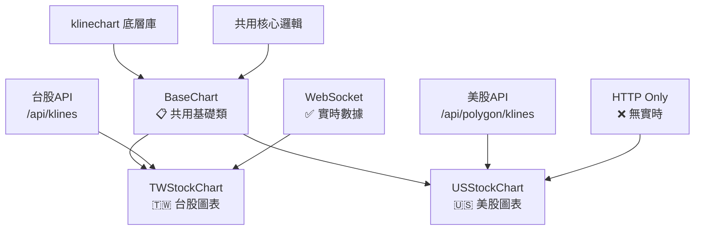

# 圖表架構設計文檔

## 📋 概述

本文檔描述新的統一圖表架構設計,目標是創建可維護、可擴展的股票圖表組件系統。

## 🎯 設計目標

### 核心需求

- **簡單清晰**:組件只負責顯示圖表、切換周期、技術指標切換
- **統一架構**:台股和美股共用基礎,減少重複代碼
- **差異化支援**:支援不同數據源 (台股API vs 美股API) 和功能 (WebSocket vs 無WebSocket)
- **易於維護**:清晰的繼承關係和職責分離

### 功能要求

1. 📊 **顯示圖表**:K線圖、技術指標、成交量
2. 🔄 **切換周期**:1m, 5m, 15m, 30m, 1h, 1d, 1w, 1M
3. 📈 **技術指標**:MA, MACD, KDJ, VOL, BOLL 等
4. 🔴 **實時更新** (台股限定):WebSocket 即時數據

## 🏗️ 架構設計

### 整體架構圖



### 組件重新命名

| 舊名稱              | 新名稱             | 說明                  |
| ------------------- | ------------------ | --------------------- |
| `KLineChartPro`     | `TWStockChart`     | 台股圖表組件          |
| `ProfessionalChart` | `TWStockChartCore` | 台股圖表核心類        |
| `USStockChart`      | `USStockChart`     | 美股圖表組件 (保持)   |
| `USStockChartCore`  | `USStockChartCore` | 美股圖表核心類 (保持) |

## 📦 BaseChart 共用基礎類

### 設計理念

BaseChart 提供所有圖表的共用功能,參考現有 `KLineChartPro.ProfessionalChart` 的穩定架構設計。

### 核心屬性

```typescript
export abstract class BaseChart {
  // 圖表實例
  protected chart: any = null
  protected container: HTMLElement | null = null

  // 基本配置
  protected symbol: string = ''
  protected interval: string = '1d'
  protected apiEndpoint: string = ''
  protected enableWebSocket: boolean = false

  // 狀態管理 (與 ProfessionalChart 相同)
  private currentKline: any = null
  private lastKlineStartTime: number = 0
  private klineDataCache: any[] = []
  protected activeIndicators: Set<string> = new Set()
  protected indicatorPanes: Map<string, string> = new Map()
  protected toggleInProgress: Set<string> = new Set()

  // 主題管理
  private theme: keyof typeof themes = DEFAULT_THEME
  private colors: ThemeColors = themes[DEFAULT_THEME]
  private indicatorStyles: ReturnType<typeof createIndicatorStyles>
}
```

### 核心方法

```typescript
// 初始化流程 (與 ProfessionalChart 完全相同)
async init(): Promise<boolean>

// 指標管理 (與 ProfessionalChart 完全相同)
setupIndicators(): void
toggleIndicator(indicatorName: string, type: 'main' | 'sub'): boolean
removeIndicatorSimple(indicatorName: string): boolean

// 狀態查詢
isIndicatorActive(indicatorName: string): boolean
getActiveIndicators(): string[]

// 生命週期管理
destroy(): void

// 抽象方法 (由子類實現)
abstract loadData(): Promise<void>
abstract initWebSocket?(): void
```

### 配置接口

```typescript
export interface BaseChartConfig {
  symbol: string // 股票代碼
  interval: string // 時間周期
  apiEndpoint: string // API 端點
  enableWebSocket?: boolean // WebSocket 功能開關
}
```

## 🇹🇼 TWStockChart (台股圖表)

### 設計說明

TWStockChart 繼承自 BaseChart,實現台股特有的功能:

- 台股 API 數據載入
- WebSocket 實時數據更新
- 台股特有的數據格式處理

### 核心實現

```typescript
class TWStockChartCore extends BaseChart {
  constructor(container: HTMLElement, symbol: string, interval: string) {
    super(container, {
      symbol,
      interval,
      apiEndpoint: '/api/klines',
      enableWebSocket: true
    })
  }

  // 實現台股數據載入
  async loadData(): Promise<void> {
    const apiUrl = `/api/klines/${this.symbol}?interval=${this.interval}&limit=200&ma_periods=5,10,20&include_indicators=true`
    // ... 台股 API 調用邏輯
  }

  // 實現 WebSocket 初始化
  initWebSocket(): void {
    this.subscribeRealtime()
  }

  // 台股特有方法 (保留現有邏輯)
  subscribeRealtime(): void { ... }
  unsubscribeRealtime(): void { ... }
  onTickData(data: TickData): void { ... }
  updateKlineFromTick(tick: TickData): void { ... }
}
```

### React 組件接口

```typescript
interface TWStockChartProps {
  symbol: string // 股票代碼
  interval?: string // 時間周期 (預設: '5m')
  height?: number // 圖表高度 (預設: 500)
  width?: number // 圖表寬度
  className?: string // CSS 類名
  enableRealtime?: boolean // 啟用實時更新 (預設: true)
  theme?: 'light' | 'dark' // 主題 (預設: 'light')
  mainIndicators?: string[] // 主圖指標 (預設: ['MA5', 'MA10', 'MA20'])
  subIndicators?: string[] // 副圖指標 (預設: ['VOL', 'MACD', 'KDJ'])
  onIntervalChange?: (interval: string) => void // 周期變更回調
}
```

## 🇺🇸 USStockChart (美股圖表)

### 設計說明

USStockChart 繼承自 BaseChart,實現美股特有的功能:

- 美股 API 數據載入 (Polygon.io)
- 無 WebSocket (免費計劃限制)
- 美股特有的數據格式和限制處理

### 核心實現

```typescript
class USStockChartCore extends BaseChart {
  constructor(container: HTMLElement, config: BaseChartConfig) {
    super(container, { ...config, enableWebSocket: false })
  }

  // 實現美股數據載入
  async loadData(): Promise<void> {
    const apiUrl = `${this.apiEndpoint}/${this.symbol}?interval=${this.interval}`
    // ... 美股 API 調用邏輯 (包含 Rate Limiting 處理)
  }

  // 美股不使用 WebSocket
  initWebSocket(): void {
    console.log('📡 美股圖表不使用 WebSocket (免費計劃不支援)')
  }
}
```

### React 組件接口

```typescript
interface USStockChartProps {
  symbol: string // 股票代碼
  interval?: string // 時間周期 (預設: '1d')
  height?: number // 圖表高度 (預設: 600)
  apiEndpoint: string // API 端點
  className?: string // CSS 類名
  onIntervalChange?: (interval: string) => void // 周期變更回調
}
```

## 🔧 技術指標系統

### 支援的指標

| 指標     | 類型 | 說明                      |
| -------- | ---- | ------------------------- |
| **MA**   | 主圖 | 移動平均線 (5, 10, 20 期) |
| **BOLL** | 主圖 | 布林通道                  |
| **VOL**  | 副圖 | 成交量                    |
| **MACD** | 副圖 | MACD 指標                 |
| **KDJ**  | 副圖 | KDJ 隨機指標              |

### 指標配置

```typescript
// 指標樣式配置 (參考 klinechart-pro/theme.ts)
const indicatorStyles = createIndicatorStyles(colors)

// 主圖指標配置
const MA_CONFIG = indicatorStyles.ma
const BOLL_CONFIG = indicatorStyles.boll

// 副圖指標配置
const VOL_CONFIG = indicatorStyles.vol
const MACD_CONFIG = indicatorStyles.macd
const KDJ_CONFIG = indicatorStyles.kdj
```

### 指標切換API

```typescript
// 切換指標
chart.toggleIndicator('MA', 'main') // 主圖 MA
chart.toggleIndicator('MACD', 'sub') // 副圖 MACD

// 查詢指標狀態
const isActive = chart.isIndicatorActive('MA')
const activeList = chart.getActiveIndicators()
```

## 📊 數據格式標準

### 統一數據格式

```typescript
interface KLineData {
  timestamp: number // 時間戳 (毫秒)
  open: number // 開盤價
  high: number // 最高價
  low: number // 最低價
  close: number // 收盤價
  volume: number // 成交量
}
```

### 台股API響應格式

```typescript
interface TWStockResponse {
  data: Array<{
    timestamp: string
    kline: {
      open: number
      high: number
      low: number
      close: number
      volume: number
    }
  }>
}
```

### 美股API響應格式

```typescript
interface USStockResponse {
  data: Array<{
    time: string
    open: number
    high: number
    low: number
    close: number
    volume: number
  }>
}
```

## 🚀 實施計劃

### Phase 1: BaseChart 重構 ✅

- [x] 創建 BaseChart 抽象類
- [x] 提取共用邏輯和屬性
- [x] 定義抽象方法接口

### Phase 2: USStockChart 完善 ✅

- [x] USStockChartCore 繼承 BaseChart
- [x] 實現美股特有的 loadData() 方法
- [x] 處理 Rate Limiting 和錯誤處理
- [x] 測試圖表顯示和周期切換功能

### Phase 3: TWStockChart 改造 🔄

- [ ] 重命名 KLineChartPro → TWStockChart
- [ ] ProfessionalChart 繼承 BaseChart
- [ ] 實現台股特有的 loadData() 和 initWebSocket()
- [ ] 移除重複代碼,保留台股特有邏輯
- [ ] 測試實時更新和指標功能

### Phase 4: 功能驗證 📋

- [ ] 台股:數據載入、周期切換、指標切換、WebSocket 實時更新
- [ ] 美股:數據載入、周期切換、指標切換、Rate Limiting 處理
- [ ] 跨瀏覽器兼容性測試
- [ ] 性能和記憶體使用測試

### Phase 5: 文檔和優化 📝

- [ ] API 文檔完善
- [ ] 使用範例和最佳實踐
- [ ] 性能優化和程式碼清理
- [ ] 單元測試覆蓋

## 📋 使用範例

### TWStockChart 使用

```tsx
import { TWStockChart } from '@/components/chart'

function TaiwanStockPage() {
  const [interval, setInterval] = useState('5m')

  return (
    <TWStockChart
      symbol="2330"
      interval={interval}
      height={600}
      enableRealtime={true}
      theme="light"
      mainIndicators={['MA5', 'MA10', 'MA20']}
      subIndicators={['VOL', 'MACD', 'KDJ']}
      onIntervalChange={setInterval}
    />
  )
}
```

### USStockChart 使用

```tsx
import { USStockChart } from '@/components/chart'

function USStockPage() {
  const [interval, setInterval] = useState('1d')

  return (
    <USStockChart
      symbol="AAPL"
      interval={interval}
      height={600}
      apiEndpoint="/api/polygon/klines"
      onIntervalChange={setInterval}
    />
  )
}
```

## ⚠️ 注意事項

### 美股 Rate Limiting

- Polygon.io 免費計劃限制:3 requests/minute, 20 秒間隔
- 短周期數據 (1m, 5m, 15m) 使用較短的日期範圍避免分頁查詢
- 前端需實現適當的防抖和用戶提示

### WebSocket 連接管理

- 台股圖表負責 WebSocket 連接的建立和清理
- 確保組件銷毀時正確關閉連接
- 處理連接中斷和重連邏輯

### 記憶體管理

- 圖表實例銷毀時正確清理 DOM 元素
- 避免重複圖表渲染問題
- 合理管理數據緩存大小

## 📚 相關文件

- [BaseChart API 文檔](./base-chart-api.md) (待創建)
- [TWStockChart API 文檔](./tw-stock-chart-api.md) (待創建)
- [USStockChart API 文檔](./us-stock-chart-api.md) (待創建)
- [技術指標配置文檔](./technical-indicators.md) (待創建)

---

**文檔版本**: v1.0
**最後更新**: 2025-09-22
**維護者**: Development Team
