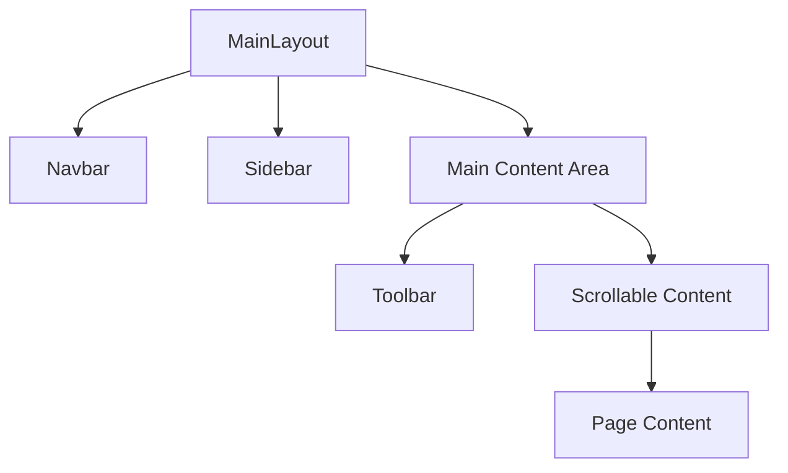

# 佈局系統文檔

本文檔說明 SinoTrade 交易平台的佈局系統架構，包括 MainLayout 和 Sidebar 元件的設計與使用方法。

## 📋 目錄

- [系統概述](#系統概述)
- [MainLayout 元件](#mainlayout-元件)
- [Sidebar 元件](#sidebar-元件)
- [響應式佈局](#響應式佈局)
- [使用範例](#使用範例)
- [最佳實踐](#最佳實踐)

## 🏗️ 系統概述

### 佈局架構

```
┌─────────────────────────────────────┐
│             Navbar                  │
├─────────────┬───────────────────────┤
│             │     Toolbar           │
│   Sidebar   ├───────────────────────┤
│             │                       │
│             │     Main Content      │
│             │                       │
└─────────────┴───────────────────────┘
```

### 核心元件關係



## 🏠 MainLayout 元件

### 基本結構

```tsx
// src/components/layout/MainLayout.tsx
export function MainLayout({ children }: MainLayoutProps) {
  const [sidebarOpen, setSidebarOpen] = useState(true);

  return (
    <View className="min-h-screen flex flex-col bg-gray-100">
      {/* 頂部導航欄 */}
      <Navbar />

      {/* 主要內容區域 */}
      <View className="flex-1 flex flex-row relative">
        {/* 側邊欄 */}
        <Sidebar isOpen={sidebarOpen} />

        {/* 手機版覆蓋層 */}
        {sidebarOpen && (
          <View className="fixed inset-0 bg-black bg-opacity-50 z-40 lg:hidden" />
        )}

        {/* 主要內容 */}
        <View className="flex-1 flex flex-col lg:relative">
          {/* 內容工具欄 */}
          <Toolbar onToggleSidebar={() => setSidebarOpen(!sidebarOpen)} />

          {/* 滾動內容區域 */}
          <View className="flex-1 p-2 lg:p-3">
            <View className="w-full pb-16">
              {children}
            </View>
          </View>
        </View>
      </View>
    </View>
  );
}
```

### 屬性說明

| 屬性 | 類型 | 必填 | 描述 |
|-----|------|------|------|
| `children` | `React.ReactNode` | ✅ | 頁面主要內容 |

### 功能特性

#### 1. 響應式佈局管理
- **桌面版**：固定側邊欄 + 內容區域
- **手機版**：覆蓋式側邊欄 + 全寬內容

#### 2. 狀態管理
```tsx
const [sidebarOpen, setSidebarOpen] = useState(true);
```

#### 3. 滾動管理
```tsx
// 確保內容可以正常滾動，底部不被截斷
<View className="w-full pb-16">
  {children}
</View>
```

## 📂 Sidebar 元件

### 基本結構

```tsx
// src/components/layout/Sidebar.tsx
export function Sidebar({ isOpen = true }: SidebarProps) {
  return (
    <View className={`
      bg-gray-50 border-r border-gray-200 min-h-screen transition-all duration-300
      ${isOpen
        ? 'w-80 lg:relative lg:translate-x-0 absolute z-50 lg:z-auto'
        : 'w-20 hidden lg:block'
      }
    `}>
      {/* 主選單 */}
      <MenuSection isOpen={isOpen} />

      {/* 監控清單 */}
      {isOpen && <WatchlistSection />}

      {/* 底部設定 */}
      <SettingsSection isOpen={isOpen} />
    </View>
  );
}
```

### 屬性說明

| 屬性 | 類型 | 預設值 | 描述 |
|-----|------|--------|------|
| `isOpen` | `boolean` | `true` | 側邊欄是否展開 |

### 功能區塊

#### 1. 主選單區域
```tsx
const menuItems = [
  { icon: '🏠', label: '首頁', active: true },
  { icon: '📊', label: '交易', active: false },
  { icon: '💼', label: '投資組合', active: false },
  { icon: '📈', label: '市場數據', active: false },
  { icon: '🔍', label: '研究分析', active: false },
  { icon: '⚡', label: '快速下單', active: false },
  { icon: '📋', label: '交易記錄', active: false },
  { icon: '💰', label: '資金管理', active: false },
];
```

#### 2. 監控清單區域
```tsx
const watchlist = [
  { symbol: 'TSLA', name: '特斯拉', price: '$248.50', change: '+2.3%', up: true },
  { symbol: 'AAPL', name: '蘋果', price: '$192.80', change: '-0.8%', up: false },
  { symbol: 'NVDA', name: '輝達', price: '$721.33', change: '+4.1%', up: true },
  { symbol: '2330.TW', name: '台積電', price: 'NT$566', change: '+1.2%', up: true },
];
```

#### 3. 響應式顯示邏輯
```tsx
// 桌面版：根據 isOpen 決定寬度
// 手機版：覆蓋模式或完全隱藏
className={`
  ${isOpen
    ? 'w-80 lg:relative lg:translate-x-0 absolute z-50 lg:z-auto'
    : 'w-20 hidden lg:block'
  }
`}
```

## 📱 響應式佈局

### 斷點行為

#### 手機版 (< 1024px)
```css
/* 側邊欄覆蓋模式 */
.sidebar-open {
  position: absolute;
  z-index: 50;
  width: 320px;
}

.sidebar-closed {
  display: none;
}

/* 背景遮罩 */
.overlay {
  position: fixed;
  inset: 0;
  background: rgba(0, 0, 0, 0.5);
  z-index: 40;
}
```

#### 桌面版 (≥ 1024px)
```css
/* 側邊欄固定模式 */
.sidebar-open {
  position: relative;
  width: 320px;
}

.sidebar-closed {
  width: 80px;
}

/* 無背景遮罩 */
.overlay {
  display: none;
}
```

### 過渡動畫

```css
.sidebar {
  transition: all 300ms ease-in-out;
}

/* 側邊欄展開/收合動畫 */
.sidebar-transition {
  transform: translateX(0);
}

.sidebar-hidden {
  transform: translateX(-100%);
}
```

## 💡 使用範例

### 基本頁面佈局

```tsx
// src/app/page.tsx
import { MainLayout } from '@/components/layout/MainLayout'

export default function TradingPage() {
  return (
    <MainLayout>
      {/* 頁面內容 */}
      <View className="space-y-4">
        {/* 市場總覽卡片 */}
        <MarketOverviewCards />

        {/* 快速交易區 */}
        <QuickTradingSection />

        {/* 圖表展示區域 */}
        <ChartSection />
      </View>
    </MainLayout>
  )
}
```

### 自定義內容區域

```tsx
// 需要特殊間距的頁面
export default function FullWidthPage() {
  return (
    <MainLayout>
      {/* 移除預設間距 */}
      <View className="-m-2 lg:-m-3">
        <FullWidthComponent />
      </View>
    </MainLayout>
  )
}
```

### 側邊欄控制

```tsx
// 程式化控制側邊欄
import { useSidebarStore } from '@/store/sidebarStore'

export function CustomToolbar() {
  const { isOpen, toggle } = useSidebarStore()

  return (
    <Button onPress={toggle}>
      {isOpen ? '👈 收合' : '👉 展開'}
    </Button>
  )
}
```

## 🎯 最佳實踐

### 1. 內容區域設計

```tsx
// ✅ 正確：使用適當的間距
<View className="space-y-4">
  <Card />
  <Card />
</View>

// ❌ 錯誤：過度巢狀容器
<View className="container">
  <View className="wrapper">
    <View className="content">
      <Card />
    </View>
  </View>
</View>
```

### 2. 響應式間距

```tsx
// ✅ 正確：響應式間距
<View className="p-2 lg:p-4 space-y-3 lg:space-y-6">

// ❌ 錯誤：固定間距
<View className="p-4 space-y-6">
```

### 3. 側邊欄狀態管理

```tsx
// ✅ 正確：使用狀態管理
const [sidebarOpen, setSidebarOpen] = useState(true)

// ✅ 正確：響應式預設狀態
const [sidebarOpen, setSidebarOpen] = useState(() => {
  return window.innerWidth >= 1024
})
```

### 4. 可訪問性考量

```tsx
// ✅ 正確：提供鍵盤導航
<Button
  onPress={toggleSidebar}
  accessibilityLabel="切換側邊欄"
  accessibilityRole="button"
>
  {isOpen ? '👈' : '👉'}
</Button>

// ✅ 正確：焦點管理
useEffect(() => {
  if (!sidebarOpen && isMobile) {
    // 側邊欄關閉時，焦點回到主內容
    mainContentRef.current?.focus()
  }
}, [sidebarOpen, isMobile])
```

### 5. 效能優化

```tsx
// ✅ 正確：條件渲染重元件
{isOpen && (
  <WatchlistSection />
)}

// ✅ 正確：使用 React.memo 避免不必要重渲染
export const Sidebar = React.memo(function Sidebar({ isOpen }) {
  // ...
})
```

## 🐛 常見問題

### 1. 側邊欄在手機版無法滑動

**問題**：iOS Safari 中側邊欄內容無法滾動

**解決方案**：
```css
.sidebar-content {
  overflow-y: auto;
  -webkit-overflow-scrolling: touch;
}
```

### 2. 佈局閃爍問題

**問題**：頁面載入時佈局會閃爍

**解決方案**：
```tsx
// 使用 useLayoutEffect 避免閃爍
useLayoutEffect(() => {
  setSidebarOpen(window.innerWidth >= 1024)
}, [])
```

### 3. 覆蓋層點擊無效

**問題**：手機版覆蓋層點擊無法關閉側邊欄

**解決方案**：
```tsx
// 確保覆蓋層在正確的 z-index 層級
<Pressable
  className="fixed inset-0 bg-black bg-opacity-50 z-40 lg:hidden"
  onPress={() => setSidebarOpen(false)}
/>
```

## 📚 相關文檔

- [響應式設計指南](./responsive-design.md)
- [元件庫指南](./components.md)
- [狀態管理](./state-management.md)

---

*最後更新：2024年9月*
*責任工程師：Frontend Team*
